<picture>
  <source media="(max-width: 620px)" srcset="assets/king-already-ascii-mobile.svg">
  
</picture>

# King Already

**Full-Stack Developer** · Software Architecture · UI Engineering

*Building reliable systems and exceptional digital experiences.*

[**Explore my GitHub →**](https://github.com/Kalready20)

---

### About Me

I'm King Already, a software developer focused on building robust full-stack applications, scalable backend systems, and thoughtfully designed digital experiences.

My work spans frontend engineering, API development, relational databases, software architecture, automated testing, cloud deployment, and security-conscious development.

I believe great software requires more than functional code. It demands clear architecture, reliable systems, intuitive interfaces, and attention to the details that make products exceptional.

**What drives my work:** Engineering quality, purposeful design, continuous improvement, and building software that solves meaningful problems.

### Engineering Focus

- **Build:** Full-stack applications, backend services, and product experiences.
- **Engineer:** API architecture, data models, workflows, automated testing, and verification.
- **Refine:** Responsive interfaces, accessibility, meaningful motion, performance, and usability.

### Technology Toolbox

- **Languages:** `TypeScript` · `JavaScript` · `Python` · `SQL` · `HTML` · `CSS`
- **Frontend:** `React` · `Next.js`
- **Backend:** `Node.js` · `NestJS` · `REST APIs`
- **Data:** `PostgreSQL` · `Prisma`
- **Quality & Delivery:** `Git` · `GitHub Actions` · `Jest` · `Pytest`
- **Cloud & Design:** `Azure` · `Figma` · `UI/UX` · `Motion`

### How I Approach Software

> Start with a clear architecture. Build with intent. Verify what matters. Make the experience feel effortless.

I value readable systems, deliberate design decisions, security-conscious development, and practical testing. Good software should be understandable to the people building it and intuitive to the people using it.

---

  Designed for clarity. Engineered with purpose.
   
  <a href="https://github.com/Kalready20">github.com/Kalready20</a>

